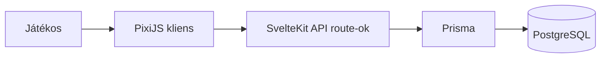

# Sokoban webjáték

## 1. Szereplők és jogosultságok

| Szerep | Igény | Felelősség / hozzáférés |
| --- | --- | --- |
| Játékos | Sokoban pályák megoldása és haladásának követése | Pályákat játszik és megtekinti a teljesített pályákat. |
| Pályaadminisztrátor | Az elérhető pályakészlet karbantartása | Pályaadatokat hoz létre, frissít és publikál. |

## 2. Use case-ek / user storyk

### Pálya játszása és teljesítése

- **Szereplő:** Játékos
- **Előfeltétel:** A játékos megnyitott egy elérhető pályát.
- **Fő folyamat:**
  1. A szereplő kiválaszt egy pályát.
  2. A rendszer megjeleníti a táblát, a játékost, a ládákat, a falakat és a célmezőket.
  3. A szereplő billentyűzettel mozgatja a játékost.
  4. A rendszer alkalmazza az érvényes mozgási és ládatolási szabályokat.
  5. A rendszer felismeri, amikor minden láda célmezőre került.
  6. A rendszer eltárolja a teljesített pályát és teljesítési visszajelzést ad.
- **Alternatív / hibafolyamatok:** Ha egy mozdulat falba vagy másik ládába tolná a ládát, a rendszer változatlanul hagyja a játékállapotot.
- **Utófeltétel:** A teljesített pálya a játékos haladási rekordjában tárolódik.

## 3. Funkcionális követelmények

| Követelmény | Elfogadási kritérium | Prioritás |
| --- | --- | --- |
| A játékos kiválaszthat egy elérhető Sokoban pályát. | Adott elérhető pályánál, amikor a játékos kiválasztja azt, a rendszer betölti és megjeleníti a táblát. | Kötelező |
| A játékos billentyűzettel mozoghat üres padlómezőkön. | Adott szomszédos üres padló- vagy célmezőnél, amikor a játékos megnyomja a megfelelő iránybillentyűt, egy mezőt lép. | Kötelező |
| A játékos egy ládát tolhat, de nem húzhat. | Adott egy láda és mögötte egy üres mező, amikor a játékos a láda felé lép, a láda egy mezőt mozdul. | Kötelező |
| A rendszer megakadályozza az érvénytelen mozdulatokat. | Adott fal vagy két egymás melletti láda, amikor a játékos ezek felé próbál lépni, a tábla állapota változatlan marad. | Kötelező |
| A rendszer felismeri a teljesített pályát. | Adott, hogy minden láda célmezőn van, amikor az utolsó szükséges láda eléri a célját, a rendszer teljesítési állapotot jelenít meg. | Kötelező |
| A rendszer tartósan tárolja a teljesített pályák haladását. | Adott teljesített pályánál, amikor a játékos újratölti az alkalmazást, a pálya teljesítettként marad megjelölve. | Kötelező |
| A játékos újraindíthatja az aktuális pályát. | Adott aktív pályánál, amikor a játékos az újraindítást választja, a tábla visszaáll a kezdeti állapotba. | Ajánlott |

Prioritás: **Kötelező** = a végtermékhez szükséges; **Ajánlott** = fontos; **Lehetséges** = idő esetén opcionális.

## 4. Üzleti szabályok és korlátok

| Szabály vagy korlát | Indoklás |
| --- | --- |
| A játékos egyszerre pontosan egy ládát tolhat, és ládát nem húzhat. | Ez határozza meg a Sokoban alapvető szabályrendszerét. |
| Ládát csak üres padlómezőre vagy üres célmezőre lehet tolni. | Megakadályozza az érvénytelen játékállapotokat. |
| Egy pálya csak akkor teljesített, ha minden láda célmezőn van. | Egyértelmű győzelmi feltételt ad. |
| A publikált pályáknak egy játékoskezdő pozíciót, valamint azonos számú ládát és célmezőt kell tartalmazniuk. | Megakadályozza a játszhatatlan vagy hibás pályaadatokat. |

## 5. Felhasználói felület és munkafolyamat

A fő navigáció egy pályaválasztó és egy játékoldalt tartalmaz. A játékoldalon jelenik meg a PixiJS-szel kirajzolt tábla, egy újraindító vezérlő és az aktuális teljesítési állapot. A játékos a billentyűzettel mozog. Teljesítés után visszatérhet a pályaválasztó oldalra, ahol a pálya teljesítettként látszik.

## 6. Nem funkcionális követelmények

| Követelmény | Ellenőrzés módja |
| --- | --- |
| Egy kiválasztott pálya normál tesztkörülmények között 2 másodpercen belül betöltődik és megjelenik. | Böngészős teljesítménymérés reprezentatív pályákkal. |
| A billentyűzetbemenet normál körülmények között 100 ms-on belül látható mozgást eredményez. | Böngészős teljesítménymérés kézi játékteszt közben. |
| Egy első alkalommal játszó felhasználó külső dokumentáció nélkül tud mozogni, ládát tolni és pályát újraindítani. | Megfigyeléses használhatósági teszt egy reprezentatív játékossal. |
| Érvénytelen vagy sikertelen backendkérés nem törli a tárolt pálya- vagy haladási adatokat. | Integrációs teszt szimulált sikertelen kéréssel. |

## 7. Nyitott kérdések és kockázatok

| Kérdés / kockázat | Hatás | Felelős | Feloldás / döntés |
| --- | --- | --- | --- |
| Hogyan azonosítsuk az anonim játékos haladását? | Befolyásolja a perzisztenciát és az adatvédelmet. | Hallgató | Kezdetben böngésző által generált azonosító; fiókok csak szükség esetén. |
| Hibás pályaadat létrehozhat megoldhatatlan táblát? | Befolyásolja a játékmenet minőségét. | Hallgató | Pályaformátum validálása és kézzel készített pályakészlet használata az MVP-ben. |
| A PixiJS tisztán integrálható a választott SvelteKit renderelési móddal? | Befolyásolja a kliens beállítását. | Hallgató | Egy játszható tábla prototipizálása a perzisztencia elkészítése előtt. |

## 8. Kezdeti technikai javaslat

### Javasolt megoldás

A javasolt rendszer egy SvelteKit webalkalmazásba ágyazott PixiJS kliensből, SvelteKit API route-okból és a Prismán keresztül elért relációs adatbázisból áll. A PixiJS kliens kirajzolja a táblát és azonnal alkalmazza a játékállapot-változásokat. A SvelteKit backend pálya- és haladási végpontokat biztosít. A Prisma a pálya-, játékoshaladási és teljesítési rekordokat képezi le az adatbázisra.

### Technológiai irány

| Terület | Jelölt technológia / megközelítés | Megfontolás oka | Nyitott kérdés / kockázat |
| --- | --- | --- | --- |
| Játékkliens | PixiJS TypeScripttel | Hatékony 2D WebGL/canvas megjelenítés és bemenetkezelés | A SvelteKit-integrációt prototipizálni kell. |
| Szerver / backend | SvelteKit | TypeScriptet használ, és ugyanabban az alkalmazásban szerver route-okat biztosít | A szerveroldali renderelés határait gondosan kezelni kell. |
| Adatbázis-elérés | Prisma | Típusos adatbázis-elérés és séma-migrációk | Az adatbázis-szolgáltatót ki kell választani. |
| Adattárolás | PostgreSQL | Megfelelő relációs tárolás pályákhoz és haladáshoz | A korai fejlesztés alatt helyi SQLite használható. |
| Telepítés | Konténeralapú felhős telepítés | Ismételhető build- és futtatókörnyezet | Megfelelő hostingplatformot kell választani. |

### Kezdeti architektúravázlat

### Megvalósíthatóság és technikai kockázatok

| Kockázat / feltételezés | A 2. félévre tervezett validáció | Tartalék megközelítés |
| --- | --- | --- |
| A PixiJS bemenete és megjelenítése megfelelően működik SvelteKitben. | Egy játszható pálya elkészítése az API-k megvalósítása előtt. | Egyszerűbb canvas-renderelő használata, ha az integráció sikertelen. |
| A haladás teljes fiókrendszer nélkül is tárolható. | Egy anonim játékos teljesítési állapotának mentése és visszatöltése. | Minimális autentikáció bevezetése, ha az anonim azonosítás megbízhatatlan. |
