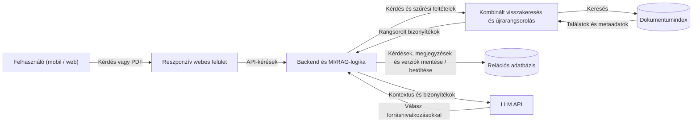

# Társasjáték-szabálymagyarázó alkalmazás forráshivatkozásokkal

## 1. Szereplők és jogosultságok

| Szerep | Igény | Felelősség / hozzáférés |
| --- | --- | --- |
| Felhasználó (Játékos) | Gyors és pontos válaszok kapása vitás társasjáték-helyzetekben, forrásokkal alátámasztva. | Játékot és szabályváltozatot választás, kérdéseket tesz fel, megjegyzéseket ment, és feltölti a szabálykönyveket. |

## 2. Use case-ek / user storyk

### Szabálykérdés megválaszolása és forrásellenőrzés

- **Szereplő:** Felhasználó
- **Előfeltétel:** A rendszerben elérhető a kiválasztott játék szabálykönyve.
- **Fő folyamat:**
  1. A szereplő kiválasztja a játékot, a kiadást és az opcionális kiegészítőket.
  2. A szereplő feltesz egy helyzetfüggő kérdést.
  3. A rendszer (LLM) a dokumentumfeldolgozó és lekérdezési folyamat segítségével visszakeres.
  4. A rendszer megválaszolja a kérdést, és a választ pontos forráshelyekkel (oldalszám, szakaszazonosító) támasztja alá.
  5. A szereplő megnyitja a hivatkozást, és megtekinti az eredeti szövegkörnyezetet.
- **Alternatív / hibafolyamatok:**
  - Ha a helyzetadat hiányos, a rendszer visszakérdez a pontosítás érdekében.
  - Ha a forrás elégtelen, a rendszer jelzi, hogy a válasz nem megállapítható.
  - Egymásnak ellentmondó források esetén a rendszer választást kér a felhasználótól, vagy feloldatlan kérdést jelez.
- **Utófeltétel:** A kérdés és a rendszer válasza mentésre kerül, rögzítve a használt dokumentumverziót is, a felhasználó pedig jelölheti, ha a válasz hibás volt.

## 3. Funkcionális követelmények

| Követelmény | Elfogadási kritérium | Prioritás |
| --- | --- | --- |
| Dokumentumok feltöltése és feldolgozása. | Adott egy szöveges PDF vagy Markdown fájl, a rendszer képes azt feldolgozni stabil szakaszazonosítókkal és szakaszhierarchiával. A feldolgozott szakaszokhoz oldalszám, dokumentumverzió és – ha létezik – szakaszcím is rögzül. | Kötelező |
| Szabálykönyv-metaadatok kezelése. | Minden feldolgozott dokumentumhoz rögzíthető a játék neve, kiadása, opcionális kiegészítője és verzióazonosítója; ezek alapján a forrás később egyértelműen azonosítható. | Kötelező |
| LLM-alapú válaszadás hivatkozásokkal. | Adott egy feltett kérdés, a rendszer a kijelölt szabálykészlet alapján válaszol, és a válasz releváns állításaihoz pontos forráshelyeket (oldalszám és szakaszazonosító) rendel. | Kötelező |
| Hivatkozott forráskörnyezet megnyitása. | Adott egy válaszban szereplő forráshivatkozás, amikor a felhasználó megnyitja, a rendszer megjeleníti az eredeti szöveget és a megfelelő környező szakaszt. | Kötelező |
| Szabályszakaszok közötti hivatkozások kezelése. | Adott egy szabályszakasz, amely másik szakaszra hivatkozik, a feldolgozó felismeri és feloldja a hivatkozást, a lekérdezési folyamat pedig szükség esetén bevonja a kapcsolódó szakaszt a bizonyítékok közé. A hivatkozás a megfelelő játékhoz és kiadáshoz kötődik. | Kötelező |
| Hiányos adatok kezelése. | Adott egy nem egyértelmű kérdés, a rendszer képes visszakérdezni a helyzet pontosítására, és a hiányzó adatot nem helyettesíti kitalált feltételezéssel. | Kötelező |
| Kiadások, kiegészítők és házi szabályok elkülönítése. | A keresés és a válaszadás mindig csak a felhasználó által kijelölt szabálykészleten (kiadás, kiegészítő) belül fut le; a házi szabályok külön jelölést kapnak. A rendszer nem használhat véletlenül más kiadásból vagy nem kiválasztott kiegészítőből származó szabályt. | Kötelező |
| Ellentmondó források kezelése. | Ha az alkalmazható források egymásnak ellentmondanak, a rendszer bemutatja az ellentmondást, és választást kér a felhasználótól vagy jelzi, hogy a kérdés a rendelkezésre álló forrásokból nem oldható fel. | Kötelező |
| Kérdések és megjegyzések tartós mentése. | Adott egy felhasználói munkamenet, a feltett kérdéseket, a rendszer válaszait és a felhasználó saját megjegyzéseit a rendszer tartósan tárolja. | Kötelező |
| Hibás válaszok jelölése és javítása. | A felhasználó képes megjelölni a hibás választ, és a javaslatot vagy megjegyzést rögzítheti. A visszajelzéshez kapcsolódik a kérdés, a válasz és a használt dokumentumverzió. | Kötelező |
| Elavult válaszok kezelése dokumentumcsere után. | Dokumentumverzió cseréjekor vagy az index újraépítésekor a régi forrásokra mutató válasz nem jelenhet meg aktuális forrásokra támaszkodó válaszként; a korábbi válasz megőrzi az eredeti dokumentumverzió azonosítóját. | Kötelező |

Prioritás: **Kötelező** = a végtermékhez szükséges; **Ajánlott** = fontos; **Lehetséges** = idő esetén opcionális (pl. többnyelvű kérdezés, táblázatok értelmezése).

## 4. Üzleti szabályok és korlátok

| Szabály vagy korlát | Indoklás |
| --- | --- |
| A keresés mindig a kijelölt szabálykészleten belül fusson. | Elkerülhető, hogy egy másik kiadás vagy kiegészítő téves szabályai kerüljenek a válaszba. |
| Minden szabályszakasz azonosítható legyen a játék, a kiadás és – ahol releváns – a kiegészítő alapján. | A források helyes alkalmazhatósága és a pontos visszakeresés biztosítása. |
| A szakaszok közötti hivatkozásokat a forrásdokumentum és a megfelelő kiadás összefüggésében kell feloldani. | A rendszer ne kövessen véletlenül másik játékból vagy eltérő kiadásból származó hivatkozást. |
| A dokumentum tartalma adatként kezelendő, nem írhatja felül az alkalmazás utasításait. | Prompt injection támadások és nem kívánt MI-viselkedés elkerülése. |
| A forráshivatkozás létezése nem bizonyítja önmagában, hogy a forrás alátámasztja az állítást. | A hivatkozás technikai érvényességét és tartalmi helyességét külön kell ellenőrizni. |
| A szolgáltatáskulcsok szerveroldalon maradjanak, titkok nem kerülhetnek a repóba. | Biztonsági alapkövetelmény az API-kulcsok (pl. LLM) védelmére. |
| Az MI hibája vagy elérhetetlensége ne okozzon adatvesztést; a felhasználó javíthassa a javaslatokat. | A felhasználói adatok megőrzése és a hibás MI-kimenetek kezelhetősége kritikus fontosságú. |
| Egy dokumentumverzió cseréje vagy index újraépítése után nem maradhat elavult forrásra mutató, aktuálisként jelölt válasz. | Az adatkonzisztencia és a hivatkozások megbízhatóságának biztosítása. |

## 5. Felhasználói felület és munkafolyamat

A rendszer egy reszponzív webes felülettel rendelkezik, amely mobilon is kényelmesen használható játék közben. A főképernyőn a felhasználó kiválaszthatja a kívánt társasjátékot és a szabályváltozatot. Ezt követően egy chat-szerű felületen teheti fel a kérdéseit. A rendszer válasza mellett jól láthatóan megjelennek a hivatkozások (oldalszám, szakaszazonosító), amelyekre kattintva egy külön panelen vagy modális ablakban megjelenik az eredeti szabálykönyv vonatkozó szövegkörnyezete. A felhasználó a felületen keresztül értékelheti a választ, illetve saját megjegyzéseket fűzhet a beszélgetéshez.

## 6. Nem funkcionális követelmények

| Követelmény | Ellenőrzés módja |
| --- | --- |
| Hatékony jelöltegyesítés és újrarangsorolás. | A kulcsszavas és szemantikus visszakeresés eredményeit egyesíteni kell, az újrarangsorolás szabályát pedig dokumentálni és kézzel ellenőrzött kérdés–válasz–forrás készleten mérni kell. Össze kell hasonlítani az egyszerű, rögzített méretű darabolást a szakaszhierarchiát és hivatkozásokat kezelő megoldással. |
| A visszakeresés minősége. | Kézzel ellenőrzött tesztkészleten mérni kell a találati arányt és a több szabályrészt igénylő kérdésekhez szükséges teljes bizonyítékkészlet megtalálását. Külön mérendő a nem kiválasztott vagy nem alkalmazható kiadásból származó találatok előfordulása. |
| A válaszok és hivatkozások pontossága. | Ellenőrzött mintákon értékelni kell a válaszok tartalmi helyességét, a hivatkozások állításokat alátámasztó erejét, valamint azt, hogy az elégtelen forrásra adott visszautasítás indokolt-e. A hivatkozás létezésének automatikus ellenőrzését külön kell kezelni a tartalmi ellenőrzéstől. |
| Hiányos és megválaszolhatatlan kérdések kezelése. | A tesztkészlet tartalmazzon hiányzó helyzetadatot, elégtelen forrást, egymásnak ellentmondó forrásokat és kiegészítőből eredő szabályeltérést. Ellenőrizni kell, hogy a rendszer megfelelő esetben visszakérdez, jelzi a bizonytalanságot vagy nem állapítható meg választ ad. |
| Késleltetés. | A lekérdezési folyamat válaszidejét reprezentatív kérdéskészleten mérni és dokumentálni kell, beleértve a visszakeresési és válaszgenerálási folyamatot. |
| Reprodukálható értékelési eljárás. | Az értékeléshez használt mintaadatok, kézzel ellenőrzött elvárt források, tesztszkriptek és az eredmények reprodukálásához szükséges útmutató elérhetők a Git-repóban. |
| Szeparált logika. | Az alkalmazás, az adattárolás, a dokumentumfeldolgozás, a visszakeresés és az MI-integráció logikája a kódbázisban egyértelműen elkülönül. |
| Adatmegőrzés hiba esetén. | Szimulált MI-szolgáltatói vagy backendhiba esetén a korábbi kérdések és megjegyzések megmaradnak, a sikertelen kérés pedig biztonságosan újrapróbálható vagy jelezhető. |

## 7. Nyitott kérdések és kockázatok

| Kérdés / kockázat | Hatás | Felelős | Feloldás / döntés |
| --- | --- | --- | --- |
| Melyik darabolási stratégia a legmegfelelőbb? | Befolyásolja a RAG találati pontosságát és a szakaszhierarchia megőrzését. | Hallgató | Az egyszerű, rögzített méretű és a szakaszhierarchiát, illetve hivatkozásokat kezelő változatok mérése és összehasonlítása tesztadatokon. |
| Hogyan kombinálható optimálisan a kulcsszavas és a szemantikus keresés? | Hatással van a pontos szakkifejezések és a tágabb értelmű kérdések megválaszolására. | Hallgató | A kombinált visszakeresés, a jelöltegyesítés és az indokolt újrarangsorolás implementálása és mérése. |
| Hogyan ellenőrizhető a hivatkozás tartalmi helyessége? | Létező szakaszra mutató hivatkozás sem feltétlenül támasztja alá a generált állítást. | Hallgató | A hivatkozás létezésének automatikus ellenőrzése és az állítást alátámasztó szerep kézzel ellenőrzött mintákon végzett értékelése különüljön el. |
| Hogyan kezelendő a dokumentumverzió vagy az index változása? | A válaszban elavult vagy más kiadásból származó forrás maradhat. | Hallgató | Verzióhoz kötött forrásazonosítás, indexfrissítési teszt és az elavult hivatkozások aktuálisként való megjelenítésének ellenőrzése. |
| Felhasználási feltételek. | A feltöltött társasjáték-szabálykönyvek jogvédettek lehetnek. | Hallgató | A választott dokumentumok felhasználási feltételeinek ellenőrzése a kutatási szakaszban, és a felhasználható mintadokumentumok kiválasztásának dokumentálása. |
| A PDF-ekből kinyert szöveg megőrzi-e a forrásoldalakat és a szakaszszerkezetet? | Hibás feldolgozás esetén a pontos forráshivatkozások és a kapcsolódó szakaszok sérülhetnek. | Hallgató | Több reprezentatív PDF és Markdown dokumentum feldolgozásának ellenőrzése; hibás PDF esetén a hiba jelzése és a Markdown-bemenet biztosítása. |

## 8. Kezdeti technikai javaslat

### Javasolt megoldás

A rendszer egy mobilon is reszponzív frontendből, egy API-t biztosító backendből és egy elkülönített MI/RAG logikából áll. A backend végzi a dokumentumok (PDF/Markdown) feldolgozását, darabolását, és az adatok vektoradatbázisba (a szemantikus kereséshez) valamint relációs adatbázisba (a tartós kérdés/dokumentum tároláshoz) mentését. A rendszer a bejövő kérdéseket kulcsszavas és szemantikus kereséssel futtatja le, egyesíti a jelölteket, majd azokat egy LLM bevonásával elemzi és generálja a hivatkozásokkal ellátott választ.

### Technológiai irány

| Terület | Jelölt technológia / megközelítés | Megfontolás oka | Nyitott kérdés / kockázat |
| --- | --- | --- | --- |
| Kliens (Frontend) | React, Vue vagy SvelteKit | Reszponzív, modern webes UI könnyű mobilalkalmazkodással. | A technológiát a fejlesztési idő, az akadálymentesség és a mobilos használhatóság alapján kell kiválasztani. |
| Backend API és RAG | Python (FastAPI) | Natív integráció és gazdag ökoszisztéma az LLM keretrendszerekhez (pl. LangChain, LlamaIndex) és dokumentumfeldolgozáshoz. | Ellenőrizni kell, hogy a dokumentumfeldolgozás, a keresés és az API-réteg önállóan tesztelhetően elkülönüljön. |
| Adatbázis (Relációs) | PostgreSQL | A felhasználói munkamenetek, kérdések, megjegyzések és dokumentum-metaadatok tartós és megbízható tárolása. | A séma őrizze meg a dokumentumverziókat, a válaszok forrásait és a házi szabályok elkülönítését. |
| Adatbázis (Vektor) | ChromaDB, Pinecone vagy PGVector | A dokumentumdarabok beágyazásainak tárolása és szemantikus keresése. | A vektoros keresést kulcsszavas kereséssel kell kombinálni; az alkalmazhatósági szűrést a keresés előtt vagy a rangsorolás során megbízhatóan érvényesíteni kell. |
| Kulcsszavas keresés és rangsorolás | Adatbázis-kereső vagy külön keresőkomponens; kombinált visszakeresés és újrarangsorolás | A pontos szakkifejezések és a szemantikai egyezések együttes használata. | A jelöltegyesítés és az újrarangsorolás módját tesztadatokon kell összehasonlítani és dokumentálni. |
| Dokumentumfeldolgozás | PDF- és Markdown-feldolgozó, szakaszhierarchia- és hivatkozásfeloldással | A stabil szakaszazonosítók, oldalszámok és kapcsolódó szabályhelyek megőrzése. | Ellenőrizni kell a PDF-oldalszámok, a szakaszhierarchia és a belső hivatkozások helyes feldolgozását. |
| LLM Szolgáltató | OpenAI API, Anthropic Claude vagy más megfelelő szolgáltató | Szövegértelmezés és válaszgenerálás a visszakeresett bizonyítékok alapján. | Az API-kulcsok szerveroldalon maradjanak; a szolgáltató hibája vagy elérhetetlensége ne okozzon adatvesztést. |

### Kezdeti architektúravázlat

Az alábbi Mermaid-diagram a rendszer fő komponenseit és azok adatáramlását mutatja be. A diagram forrása közvetlenül ebben a Markdown-fájlban található, így nincs szükség külön képfájlra.

## 9. Megvalósíthatóság és technikai kockázatok

| Kockázat / feltételezés | A fejlesztés során tervezett validáció | Tartalék megközelítés |
| --- | --- | --- |
| A szakaszhierarchiát és hivatkozásokat kezelő feldolgozás javítja a több szabályrészt igénylő kérdések visszakeresését. | Ugyanazon, kézzel ellenőrzött kérdés–válasz–forrás készleten össze kell hasonlítani a rögzített méretű darabolást a szakaszhierarchiát és hivatkozásokat kezelő változattal. Mérni kell a teljes bizonyítékkészlet megtalálását és a nem megfelelő kiadásból származó találatokat. | Az egyszerű, rögzített méretű megoldás megtartható összehasonlítási alapként; a végleges megközelítést a dokumentált mérési eredmények alapján kell kiválasztani. |
| A kulcsszavas és szemantikus keresés eredményei megfelelően egyesíthetők és rangsorolhatók. | Külön kell mérni a kulcsszavas, a szemantikus és a kombinált keresést, majd dokumentálni kell az alkalmazott jelöltegyesítési és újrarangsorolási eljárást. | A legegyszerűbb mérhető kombinált módszert kell megtartani, és a rangsorolást csak ellenőrzött kísérletek alapján összetettebbé tenni. |
| A feldolgozott dokumentumok szakaszai és belső hivatkozásai stabilan azonosíthatók. | Reprezentatív PDF- és Markdown-fájlokon ellenőrizni kell az oldalszámokat, a szakaszazonosítókat, a hivatkozások feloldását és a megnyitott forráskörnyezet helyességét. | A feldolgozási hibát a rendszer jelezze; az érintett dokumentum ne kerüljön észrevétlenül hibás hivatkozásokkal az aktív indexbe. |
| A hivatkozások tartalmi alátámasztó szerepe megbízhatóan értékelhető. | Kézzel ellenőrzött mintákon külön kell megvizsgálni, hogy a hivatkozás létezik-e, illetve ténylegesen alátámasztja-e a hozzá kapcsolódó állítást. | A bizonytalan vagy alá nem támasztott állítások esetén a rendszer jelezze a bizonytalanságot, illetve elégtelen bizonyíték mellett ne állítson biztos választ. |
| Dokumentumverzió- vagy indexcsere esetén elavult forrás nem marad aktuálisként megjelölve. | Integrációs tesztben dokumentumverziót kell cserélni és az indexet újraépíteni; ellenőrizni kell a korábbi válaszok verzióhoz kötését és az új válaszok forrásait. | A régi válasz történeti rekordként megőrizhető, de egyértelműen a korábbi verzióhoz kell kötni, és nem szabad aktuális forrásokra támaszkodóként megjeleníteni. |
| Az LLM-szolgáltató hibája vagy elérhetetlensége nem okoz adatvesztést. | Szimulált szolgáltatói hibával ellenőrizni kell, hogy a kérdések és megjegyzések megmaradnak-e, és a felhasználó érthető hibaüzenetet kap-e. | A kérdés és a megjegyzések mentése legyen független a válaszgenerálás sikerétől; a sikertelen lekérdezés legyen újrapróbálható. |
| A kiválasztott szabálykönyvek felhasználhatók a fejlesztésben és a tesztelésben. | A kiválasztott dokumentumok felhasználási feltételeit a kutatási szakaszban ellenőrizni kell, és dokumentálni kell a felhasznált minták eredetét és felhasználhatóságát. | Olyan dokumentumot vagy mintát kell választani, amelynek tesztelési célú felhasználása megengedett; a nem tisztázott jogállású dokumentumot ki kell hagyni. |
